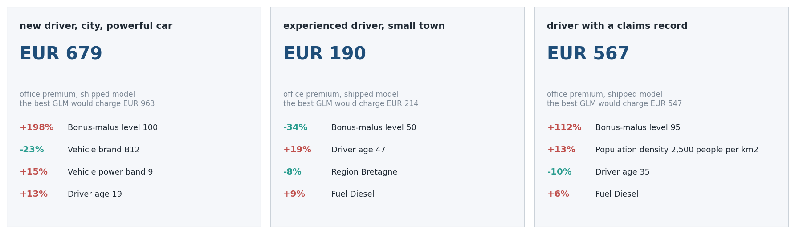
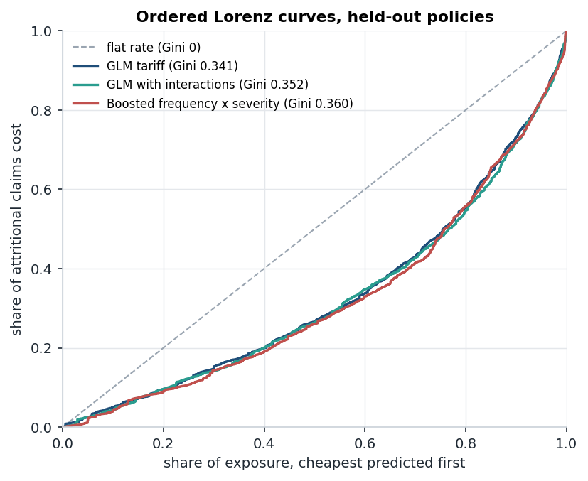
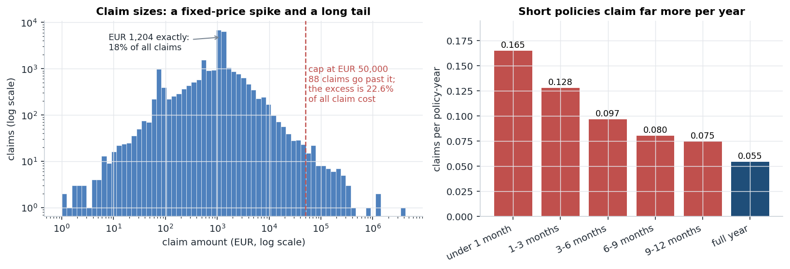
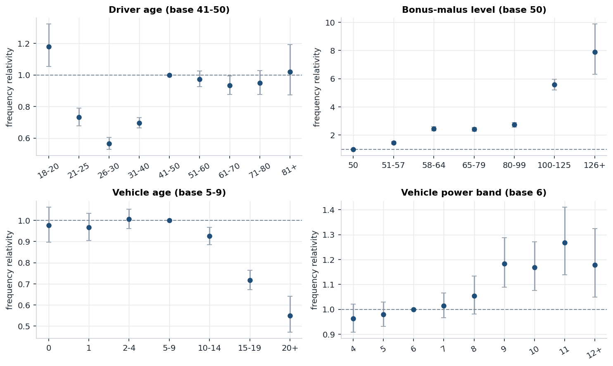
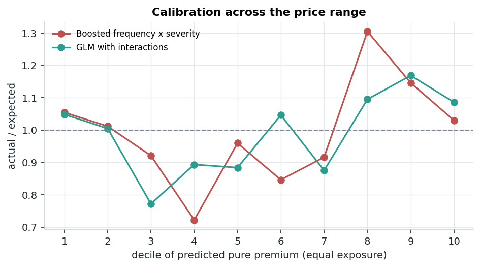
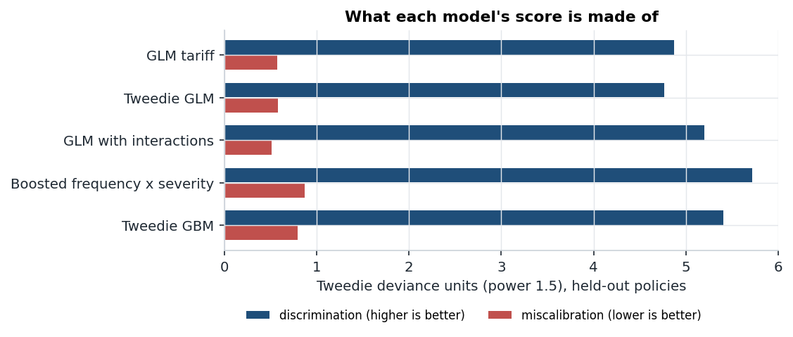
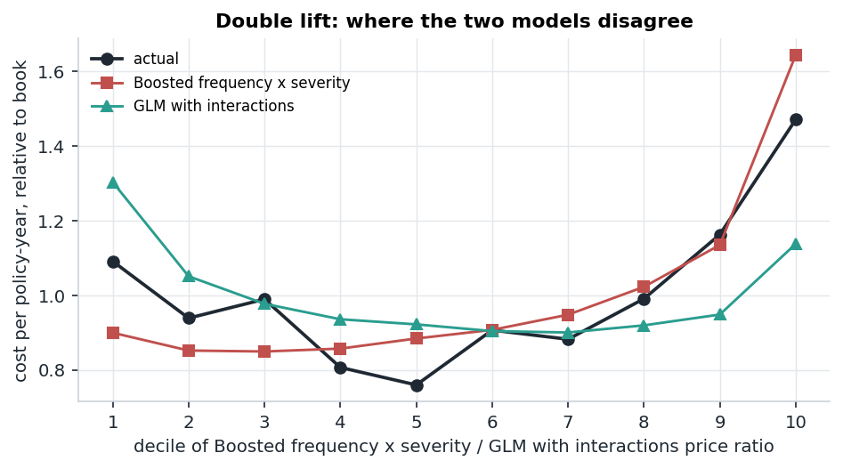
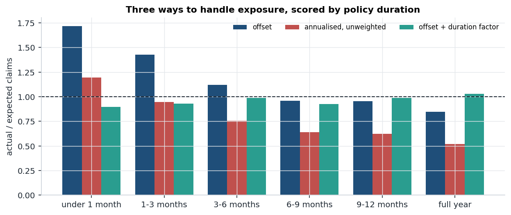
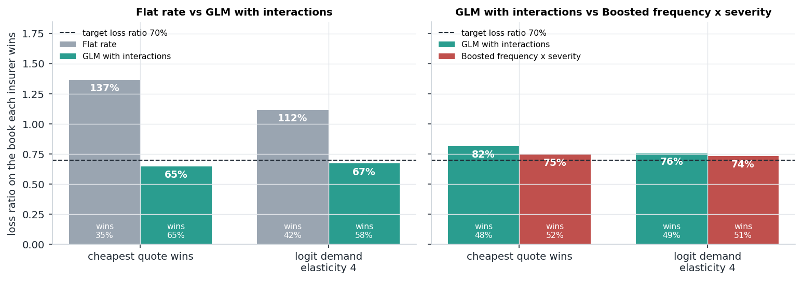

# ratecraft

[](https://github.com/ranjithguggilla/ratecraft/actions/workflows/ci.yml)

A motor insurance tariff built the way a pricing team builds one, then checked
the way their reviewer would check it. It prices third-party liability cover
for 677,991 French policies: claim frequency with exposure-offset GLMs, claim
size with a capped severity model plus a large-loss loading, and
gradient-boosted challengers that only ship if they beat the GLM by a margin I
fixed before the test fold was opened.

Most of the work went into evaluation rather than fitting. Every model is
scored on held-out risk profiles with deviance and an ordered Lorenz curve,
its score is split into the part a recalibration could fix and the part it
could not, the two strongest models are compared head to head on a double-lift
chart, and a simulated two-insurer market turns the differences into euros.
Along the way the data turned up two things I did not expect, and both are
written up below: severity is almost unpredictable from the rating factors,
and the textbook way of handling exposure is visibly wrong on this table.

## Demo

The Gradio screen takes one customer and returns the office premium, the
technical price under it, and the four factors that moved the price most,
measured against an average policy.



Those cards are the pricer's own output for three made-up customers, produced
by `scripts/run_all.py` through the same `quote()` function the screen calls.
The text version is in [results/app_demo.md](results/app_demo.md). The
19-year-old new driver is where the two strongest models disagree most: the
booster asks EUR 679 and the GLM with interactions asks EUR 963.

## Results in one table

Everything below is measured on the test fold: 135,633 policies, 71,617
policy-years and 5,248 claims, from risk profiles that never appeared in
training or validation. The score is Tweedie deviance at power 1.5 on
attritional cost (each claim capped at EUR 50,000), chosen before any model
was fitted. "Improvement" is the share of the flat rate's deviance a model
removes.

| model | validation improvement | test improvement | Gini | balance on total cost |
|---|---|---|---|---|
| flat rate | 0 | 0 | 0 | 1.017 |
| GLM tariff: Poisson frequency x gamma severity | 4.65% | 5.65% | 0.341 | 1.012 |
| Tweedie GLM, power 1.35 | 4.50% | 5.50% | 0.339 | 1.018 |
| GLM with two interaction terms | 4.93% | 6.16% | 0.352 | 1.012 |
| **boosted frequency x boosted severity (shipped)** | **5.42%** | **6.37%** | **0.360** | 1.017 |
| Tweedie GBM | 5.37% | 6.06% | 0.349 | 1.018 |



The selection rule ships the simplest model unless the next tier of complexity
buys at least 5% more improvement on the validation fold. The two interaction
terms bought 6.0% over the plain GLM tariff, and the booster bought 9.8% over
the GLM with interactions, so the booster ships.

I would not oversell that. On the test fold the booster's lead over the GLM
with interactions is 0.21 points of improvement, and a bootstrap that
resamples whole risk profiles puts the 95% interval at -0.15 to +0.55 points;
the booster comes out ahead in 88.5% of 200 resamples. It is a real edge and a
small one. If a regulator wanted a filed rating plan, the GLM with interactions
is the model I would hand over, and the app shows its price next to the
booster's for exactly that reason.

## What the data looked like



| check | result |
|---|---|
| claim rows without a policy / policies whose count disagrees with their claim rows / non-positive amounts | 0 / 0 / 0 |
| policies with more than one year of exposure | 1,224, up to 2.01 years; capped at 1 |
| policies in force for under a month | 114,792 |
| policies with more than four claims | 8, carrying 71 of the 26,444 claims |
| claims of exactly EUR 1,204 / exactly EUR 1,128.12 | 18.1% / 11.6% |
| claims between EUR 1,100 and EUR 1,300 | 44.0% |
| share of total cost in the largest 1% of claims | 38.0% |
| claims above EUR 50,000 | 88, and their excess is 22.6% of all cost |
| rows that share every rating factor with another row | 257,908 (38.0%) |
| neighbouring rows inside a shared profile with consecutive policy ids | 40.9% |

The CASdatasets 1.2 release reconciles cleanly: every policy's claim count
matches its claim rows. The claim sizes are stranger. Almost 30% of claims are
for exactly EUR 1,204 or EUR 1,128.12, which looks like fixed-rate settlements
between insurers rather than assessed damage, and that spike is a large part
of why severity is so hard to predict.

The Area letter is population density in disguise: every A policy sits at 1 to
50 people per km2 and every F at 10,008 or more, so the models use log density
and leave Area out. The repeated profiles drove the split: rows are dealt into
folds by profile, never one by one, so no customer's second record can sit in
the test fold while the first is in training.

## Frequency and severity on their own

| frequency model (test) | Poisson deviance improvement | Gini |
|---|---|---|
| flat rate | 0 | 0 |
| GLM, main effects | 4.70% | 0.293 |
| GLM with interactions | 5.07% | 0.301 |
| boosted | 5.63% | 0.315 |

| severity model (test, 5,248 claims) | gamma deviance improvement | Gini |
|---|---|---|
| flat mean, EUR 1,743.64 | 0 | 0 |
| GLM | 0.28% | 0.045 |
| boosted | 0.43% | 0.047 |

Nearly all the signal is in frequency. The severity GLM only beat the flat
mean on validation once its ridge penalty reached 0.01; at 0.001 and below it
fitted noise and lost to the mean. The search settled on 0.1.

The interaction search tried every pair of eight rating factors on the
frequency GLM and kept a pair only if it cut validation deviance by at least
1% of the GLM's own improvement over the flat rate. Driver age x bonus-malus
went in first, bonus-malus x vehicle brand second, and the third round's best
candidate (vehicle age x bonus-malus) fell 4% short of the bar.

## Rating factors



Bonus-malus dominates the tariff. The 100 to 125 band, where every new driver
starts, claims at 5.57 times the rate of the 50 band (95% interval 5.21 to
5.95). Because bonus-malus already carries most of the inexperience, driver
age 18 to 20 is only 1.18 times the 41 to 50 base once both are in the model,
while 26 to 30 sits at 0.57. Cars aged 20 or more claim at 0.55 times the 5 to
9 base, and diesel at 1.20 times petrol.

## Calibration





| model | discrimination | miscalibration |
|---|---|---|
| GLM tariff | 4.87 | 0.58 |
| Tweedie GLM | 4.77 | 0.58 |
| GLM with interactions | 5.20 | 0.51 |
| boosted frequency x severity | 5.72 | 0.87 |
| Tweedie GBM | 5.40 | 0.79 |

The Murphy decomposition writes each test score as miscalibration minus
discrimination plus a fixed uncertainty term (76.14 here), using an isotonic
recalibration of each model's own predictions. The booster ranks risks best and
is also the least well calibrated of the five. An isotonic recalibration
fitted on the validation fold would claw some of that 0.87 back; it is the
cheapest improvement left on the table and I have not taken it yet.



The double-lift chart sorts the test policies by the ratio of the booster's
price to the GLM's. In 8 of the 10 deciles the booster's line is closer to
actual cost. In the decile where the booster is dearest relative to the GLM,
actual cost runs at 1.47 times the book average, the booster says 1.64 and the
GLM 1.14: the booster has the direction right and overshoots.

Checked level by level across 52 levels of six rating factors with
model-diagnostics' bias test, each of the two models has exactly one level
biased at p < 0.01 (vehicle age 10 to 14, for both), which is about what
chance alone produces.

## The exposure problem

Short policies claim far more per year than long ones: 0.165 claims per
policy-year for policies in force under a month against 0.055 for full-year
policies, three times the rate. The standard frequency model assumes claims
are proportional to time on cover, so I scored three ways of handling it on
the same frequency GLM.



| actual / expected by duration (test) | under 1 month | 1-3 months | 3-6 months | 6-9 months | 9-12 months | full year |
|---|---|---|---|---|---|---|
| log-exposure offset | 1.72 | 1.43 | 1.12 | 0.96 | 0.95 | 0.85 |
| claims / exposure, unweighted | 1.20 | 0.95 | 0.75 | 0.64 | 0.62 | 0.52 |
| offset plus a duration factor | 0.90 | 0.93 | 0.99 | 0.92 | 0.99 | 1.03 |

The shortcut that annualises each policy's claims and fits that without
weights is simply broken: it overstates the whole book's claims by 58%,
because a two-week policy with one claim becomes an annual rate of 26.

The offset model balances overall (1.019) but under-predicts the shortest
policies by 42% and over-predicts full-year ones by 18%. A duration factor
fixes the calibration, with relativities from 2.60 for under a month down to
1.26 for nine to twelve months, and it implies a mean full-year claim rate of
0.061 against the offset model's 0.080, 24% lower.

I still ship the offset model, deliberately. The table has no dates, so it
cannot say why short policies claim more, and the two obvious stories pull in
opposite directions. If a claim tends to end the policy (French insurers can
cancel after a claim, and a written-off car ends its own cover), then claims
over time on cover is the right estimate of the hazard, and the duration model
would underprice every full-year contract by about a quarter. If short policies
are mostly new business, which is riskier than renewals, the duration model is
right for renewals and the offset model overcharges them. The offset model is
the one that stays balanced under both stories; with policy start and end
dates, this would be the first thing I would settle.

## Does the split matter?

Over five seeds, with the same model settings, the booster's test improvement
was 5.75% (sd 0.24 points) with profile-grouped splits and 5.67% (sd 0.18)
with plain row-level splits; the GLM's was 4.85% and 4.62%. Under a row-level
split 32.6% of test rows have their exact profile in training, and it still
did not flatter either model. I kept the grouped split anyway: it costs
nothing, and a measured null result is worth more than an assumed one.

## Large losses

The 88 claims above EUR 50,000 are capped for modelling and charged back as a
flat loading fitted on training claims only: 34.1% on top of attritional cost.
For the GLM tariff, the threshold changes things like this:

| threshold | loading | training claims above it | test Gini, total cost | test balance, total cost |
|---|---|---|---|---|
| EUR 25,000 | 42.9% | 102 | 0.372 | 1.014 |
| EUR 50,000 | 34.1% | 50 | 0.368 | 1.012 |
| EUR 100,000 | 26.6% | 24 | 0.363 | 1.009 |
| no cap | 0 | 0 | 0.335 | 0.928 |

Leaving the tail in costs ranking power (Gini 0.335 against 0.368) and leaves
the book 7% underpriced on the test fold.

## What it is worth

Two insurers quote every test policy at their own technical price divided by
the same 70% target loss ratio, and each customer either takes the cheaper
quote or splits by a logit demand curve. Each insurer then pays the
attritional claims of the customers it won; large losses are pooled and
charged identically by both, so they do not change who wins.



| market | demand | insurer | customers won | loss ratio | underwriting result per 100,000 policy-years |
|---|---|---|---|---|---|
| flat rate vs GLM with interactions | cheapest quote wins | flat rate | 35.2% | 136.7% | -EUR 11.49M |
| | | GLM with interactions | 64.8% | 64.9% | +EUR 1.26M |
| | logit, elasticity 4 | flat rate | 41.5% | 111.6% | -EUR 6.81M |
| | | GLM with interactions | 58.5% | 67.1% | +EUR 1.04M |
| GLM with interactions vs booster | cheapest quote wins | GLM with interactions | 48.3% | 81.7% | -EUR 1.19M |
| | | booster | 51.7% | 74.7% | +EUR 0.04M |
| | logit, elasticity 4 | GLM with interactions | 49.5% | 75.6% | -EUR 0.10M |
| | | booster | 50.5% | 73.5% | +EUR 0.26M |

A flat-rate insurer facing a GLM competitor keeps about a third of the market
at a 137% loss ratio, which is adverse selection in its purest form. Against the
booster, the GLM insurer still loses EUR 1.19M per 100,000 policy-years when
every customer shops on price and EUR 0.10M under the softer demand curve. The
booster itself only breaks even in the hard case (74.7% loss ratio against a
70% target), because the winner's curse cuts both ways: it also wins the
customers it underprices.

The assumptions, all in `CostModel` in `src/ratecraft/config.py`: a 70% target
loss ratio, expenses of 25% of premium, a logit price elasticity of 4 (a quote
10% dearer than the rival's wins 41% of customers instead of 50%), and results
scaled to 100,000 earned policy-years per insurer. The incumbent-versus-
challenger framing is a stylised market; real customers do not all see both
quotes.

## How it works

```
  CASdatasets at a pinned commit, sha256-checked
        |   sparse git fetch, read with the pure-Python rdata parser
        v
  [1] audit        counts vs claim rows, exposure, claim-size tail,
        |          repeated risk profiles
        v
  [2] prepare      cap exposure at one year, cap claims at EUR 50,000,
        |          band the rating factors, log density
        v
  [3] split        60 / 20 / 20 by risk profile, never by row
        |
        +-- frequency   Poisson GLM, log-exposure offset (glum)
        |               + greedy interaction search on validation
        |               Poisson LightGBM, log-exposure init score
        +-- severity    gamma GLM (ridge) and gamma LightGBM, claim-count weights
        +-- direct      Tweedie GLM (power chosen on validation), Tweedie LightGBM
        |
        v
  [4] select       simplest tier ships unless the next buys 5% more
        |          validation improvement
        v
  [5] evaluate     test fold, once: deviance, Gini, Murphy split, A/E,
        |          double lift, bias by factor, profile bootstrap,
        |          large-loss, exposure and split studies
        v
  [6] price        attritional pure premium x (1 + loading) / 70%
        |          reasons from GLM terms or TreeSHAP, against an average policy
        v
  [7] market       two insurers quote the test fold, customers choose
```

## Installation

```bash
git clone https://github.com/ranjithguggilla/ratecraft.git
cd ratecraft
python -m pip install -e ".[dev]"
```

Python 3.10 or newer, CPU only. The first run downloads about 9.5 MB of source
data into `data/raw/`; nothing else needs a network.

## Usage

Rebuild every number, table and chart in this README:

```bash
python scripts/run_all.py
```

That takes a little over two minutes on four CPU cores, plus the download the
first time. It fetches and verifies the data, runs five cached stages (`frequency_glm`, `frequency_gbm`,
`severity`, `direct`, `studies`) and then `report`, which writes `results/`,
`assets/` and the fitted pricer.

Rerun one stage, reusing the cached ones before it:

```bash
python scripts/run_all.py --stage studies --stage report
```

Try the whole pipeline on a synthetic book without downloading anything:

```bash
python scripts/run_all.py --synthetic 20000 --root /tmp/ratecraft-demo
```

Open the quoting screen (after a full run, so `results/model.joblib` exists):

```bash
ratecraft-app            # or: python -m ratecraft.app --port 7860
```

Price customers from Python:

```python
import joblib
from ratecraft.pricing import quote

pricer = joblib.load("results/model.joblib")
q = quote(pricer, {
    "DrivAge": 19, "VehAge": 2, "VehPower": 9, "BonusMalus": 100, "VehBrand": "B12",
    "VehGas": "Regular", "Density": 9_000, "Region": "Ile-de-France",
})
print(round(q.office), [r.sentence() for r in q.reasons])
```

Check a fresh run against the committed numbers:

```bash
cp results/metrics.json /tmp/committed.json
python scripts/run_all.py
python scripts/verify_metrics.py /tmp/committed.json results/metrics.json
```

## Configuration

Everything two modules have to agree on lives in `src/ratecraft/config.py`.

| setting | default | what it does |
|---|---|---|
| `EXPOSURE_CAP` | 1.0 | exposure above one policy-year is treated as a data error |
| `LARGE_LOSS_THRESHOLD` | 50,000 | per-claim cap for modelling; the excess becomes the loading |
| `LARGE_LOSS_SENSITIVITY` | 25k, 50k, 100k, none | thresholds in the sensitivity table |
| `SPLIT_FRACTIONS` | 0.6, 0.2, 0.2 | train, validation, test, dealt by risk profile |
| `BANDS` | see file | band edges and base levels for the GLM rating factors |
| `EVAL_POWER` | 1.5 | Tweedie power of the scoring deviance shared by every model |
| `SHIP_MARGIN` | 0.05 | extra validation improvement a more complex tier must buy |
| `GLM_ALPHAS`, `SEVERITY_ALPHAS` | see file | ridge grids searched on validation |
| `TWEEDIE_POWERS` | 1.2 to 1.8 | variance powers tried for the Tweedie models |
| `INTERACTION_MAX_TERMS`, `INTERACTION_MIN_GAIN` | 3, 0.01 | limits on the interaction search |
| `GBM_GRID`, `GBM_BASE_PARAMS` | 6 tree shapes | LightGBM settings; early stopping on validation |
| `CostModel` | 70%, 25%, 4, 100,000 | target loss ratio, expense ratio, elasticity, book size |
| `SEED` | 7 | split, boosters and synthetic data |

## Output structure

```
results/
  metrics.json                every number quoted here; CI diffs it
  model_scores.csv            the six pure-premium models, validation and test
  frequency_models.csv        frequency models on their own
  severity_models.csv         severity models on their own
  frequency_relativities.csv  GLM relativities with 95% intervals
  interaction_search.csv      every pair tried, every round, with its gain
  actual_vs_expected.csv      A/E by decile for the shipped and best GLM models
  double_lift.csv             booster against the GLM by price-ratio decile
  bias_by_factor.csv          bias test per rating-factor level
  large_loss_sensitivity.csv  the threshold table
  exposure_treatments.csv     A/E by duration for the three exposure treatments
  frequency_by_duration.csv   raw claim rate by duration
  split_leakage.csv           grouped against row-level splits, five seeds
  market_simulation.csv       both markets, both demand curves
  app_demo.md                 the pricer's quotes for three example customers
  model.joblib                fitted pricer (rebuilt locally, uploaded by CI)

assets/
  app_demo.png  data_audit.png  lorenz.png  murphy.png  calibration.png
  double_lift.png  relativities.png  exposure.png  market.png
```

## Project structure

```
src/ratecraft/
  config.py      data pin, bands, model grids, cost assumptions
  data.py        fetch and verify, parse the .rda files, attach claim totals
  audit.py       measured data checks, nothing silently fixed
  split.py       risk-profile groups and grouped or row-level splits
  features.py    banded GLM factors and raw booster columns, fixed levels
  largeloss.py   claim cap and the large-loss loading
  glm.py         glum components, relativities, alpha and interaction search
  gbm.py         LightGBM components with offsets, monotone bonus-malus
  metrics.py     deviances, Lorenz and Gini, A/E, double lift, Murphy, bootstrap
  pricing.py     pure-premium models, the pricer, quotes and reasons
  market.py      the two-insurer market simulation
  pipeline.py    the cached stages and the exposure and split studies
  report.py      selection, test scoring and every output file
  plots.py       charts only, no measurement
  synth.py       synthetic book with the real schema, for tests and smoke runs
  app.py         Gradio quoting screen

scripts/
  run_all.py         rebuilds results/ and assets/
  verify_metrics.py  diffs a fresh metrics.json against the committed one

tests/           99 tests, none of which need the network or the real data
data/README.md   where the data comes from and why it is not committed
```

## Technical details

**Exposure.** Frequency models carry `log(exposure)` as an offset: glum takes it
directly and LightGBM gets it as an init score, which is added to the raw
prediction and never fitted. For Poisson this is the same model as an
exposure-weighted rate. The Tweedie models are fitted on cost per policy-year
with exposure as the weight, because that form gives cost a variance that grows
in proportion to time on cover, as a compound Poisson process does; an offset
on total cost would make it grow like exposure to the power p.

**Interactions.** The GLMs are written as formulas (`C(drv_age) + ... +
C(drv_age):C(bonus_malus)`), and formulaic codes an interaction against main
effects that are already present, so no column is redundant. Explanations
split an interaction's contribution evenly between its two factors so the
per-factor effects still multiply back to the price exactly; a test checks
that.

**Boosters.** Bonus-malus is constrained to be monotone increasing. Training
predictions are rescaled once so they sum to the training claims, because trees
do not balance on their own the way a canonical-link GLM with an intercept
does (the scale factors were 0.996 for frequency and 1.048 for the Tweedie
booster). Quote reasons come from LightGBM's built-in TreeSHAP contributions,
which are already measured against the booster's average prediction.

**Scoring.** Every pure-premium model is compared with one Tweedie deviance at
power 1.5. Any power gives a strictly consistent score for the mean, so fixing
one in advance compares the models fairly without favouring the Tweedie fits.
The Lorenz curve treats tied predictions as one block, so a flat rate gets a
Gini of exactly zero. In the Murphy decomposition, isotonic blocks with no
claims have a mean of zero, which the score does not accept, so they are
floored at a negligible positive value.

**Uncertainty.** The bootstrap resamples whole risk profiles rather than
policies, for the same reason the split does.

**Versions.** Measured with glum 3.4.1, tabmat 4.2.1, formulaic 1.2.2,
LightGBM 4.7.0, model-diagnostics 1.4.2, rdata 0.11.2, scikit-learn 1.7.2,
pandas 2.3.3, numpy 2.2.6 and Gradio 6.28.0 on Python 3.10; the exact pins are in
`requirements.txt`.

## Testing

```bash
pytest
pytest --cov=ratecraft --cov-report=term-missing
ruff check .
```

99 tests at 93% line coverage, all on synthetic data. A few that matter more
than the rest:

- the offset GLM recovers the simulated effects, balances on its training data,
  and matches statsmodels' coefficients on the same design
- the interaction search finds an interaction planted in simulated data
- a worse bonus-malus never makes a booster's quote cheaper
- quote reasons multiply back to the exact quoted price
- the selection rule is pinned on promoted, refused and skipped tiers
- a regression test for a real bug: the R row names on the raw table once
  shifted every categorical column by one row
- the full pipeline runs end to end on a synthetic book through `run_all.py`

CI runs ruff and pytest on Python 3.10 and 3.12 for every push and pull
request. On `main` a second job downloads the pinned data, reruns every stage
from scratch, fails if any committed result moves by more than 1% (timings,
the booster's internal round count and the worded quote reasons are left out
of that check, see `scripts/verify_metrics.py`), and uploads the fitted pricer
with the results and charts as a build artifact. On the machine that produced
these numbers, a from-scratch rerun reproduced every digit.

## Dataset

freMTPL2freq and freMTPL2sev, French motor third-party liability policies and
claims, from the CASdatasets R package by Christophe Dutang and Arthur
Charpentier: <https://github.com/dutangc/CASdatasets> (release 1.2-1, commit
`227fb56`). Documentation:
<https://dutangc.github.io/CASdatasets/reference/freMTPL.html>. The package is
GPL-licensed, so the files are downloaded on demand and never committed here;
see [data/README.md](data/README.md).

## License

MIT, see [LICENSE](LICENSE). The data keeps its own GPL licence.
